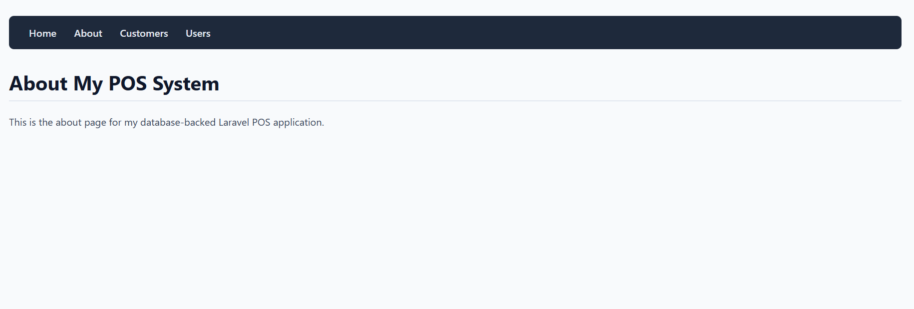
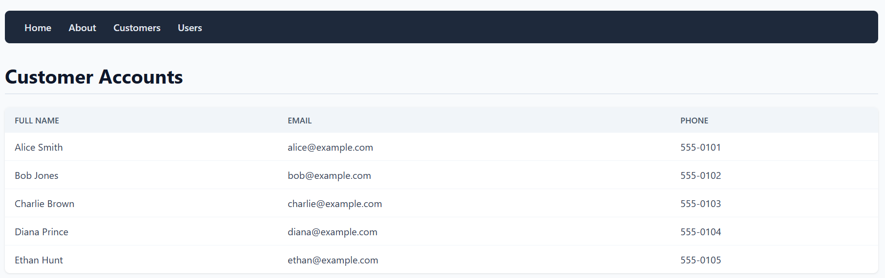
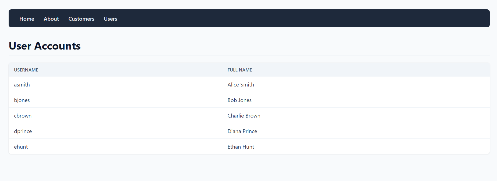
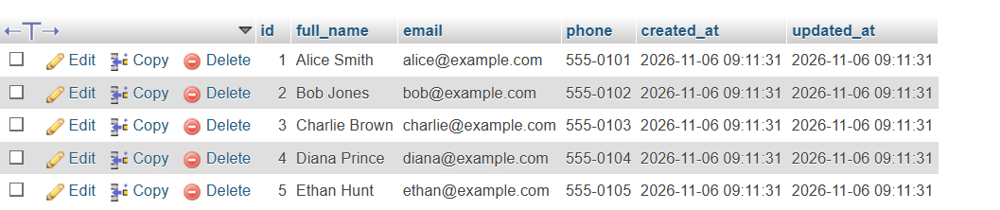

# IT0049 - Technical Formative Assessment 5 and 6 (TFA 5 & 6)
## From Arrays to Eloquent: Database-Backed Laravel POS Application[cite: 2]

This project is a database-backed upgrade of the POS application, transitioning from temporary static arrays to a fully persistent database architecture using Laravel Migrations, Seeders, and Eloquent ORM[cite: 2].

---

## 📸 Application Screenshots

### 1. About Page

### 2. Customer Accounts Page

### 3. User Accounts Page

### 4. Database Records (Database View)

---

